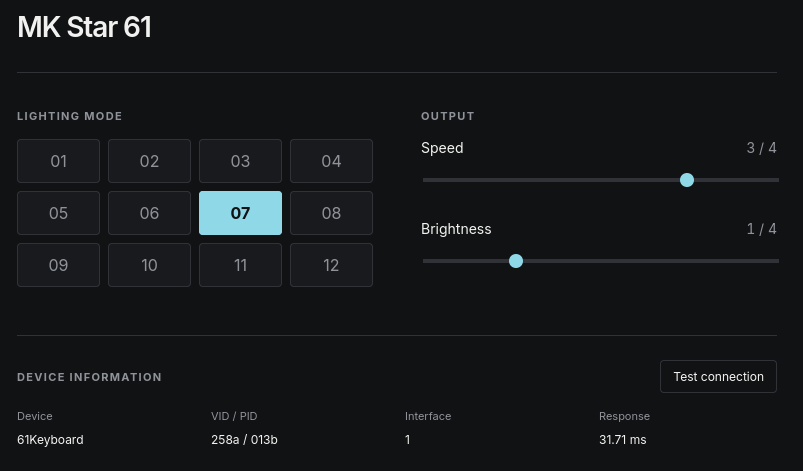

<div align="center">

# MK Star 61 RGB Controller

Control the lighting of an MK Star 61 keyboard through a local HID-powered web application.

[](https://github.com/JanGunar/mk-star-61-rgb/actions/workflows/ci.yml)
[](https://www.python.org/)
[](https://flask.palletsprojects.com/)
[](https://www.linux.org/)

</div>

<br>



## Overview

MK Star 61 RGB Controller is a lightweight Linux application for controlling keyboard lighting through the USB HID interface. It combines a Flask API, a minimal browser interface, automatic device discovery, diagnostics, a mock hardware backend, and automated tests.

The project was built to explore:

- USB HID communication
- REST API design
- Linux device permissions with `udev`
- Hardware-independent testing
- Python application packaging
- Continuous integration with GitHub Actions

## Features

- Select one of 12 lighting modes
- Adjust lighting speed and brightness
- Discover the keyboard by VID/PID instead of a hardcoded device path
- Select the correct HID interface automatically
- Inspect device information and response time
- Return clear API errors when the device is unavailable
- Configure Linux permissions with one setup command
- Run without hardware using the mock backend
- Use the application through a packaged CLI
- Run automated tests locally and in GitHub Actions

## How It Works

```text
Browser UI
    │
    ▼
Flask REST API
    │
    ├── Validation
    ├── Health check
    └── Diagnostics
         │
         ▼
    HID controller
         │
         ├── Real keyboard
         └── Mock device
```

## Project Layout

```text
.
├── app.py                         # Flask application and API routes
├── hid_controller.py              # HID discovery and communication
├── server.py                      # CLI entry point
├── udev_setup.py                  # Linux permission setup
├── index.html                     # Frontend interface
├── tests/
│   ├── conftest.py
│   ├── test_app.py
│   └── test_hid_controller.py
├── pyproject.toml
├── requirements.txt
└── .github/workflows/ci.yml
```

## Requirements

- Linux
- Python 3.10 or newer
- MK Star 61 keyboard for real-device mode
- USB HID support

## Installation

```bash
git clone https://github.com/JanGunar/mk-star-61-rgb.git
cd mk-star-61-rgb

python3 -m venv .venv
source .venv/bin/activate
python -m pip install -e ".[test]"
```

## Device Setup

The keyboard is identified by:

| Property | Value |
|---|---|
| Vendor ID | `258a` |
| Product ID | `013b` |
| HID interface | `1` |

Install the required `udev` rule:

```bash
sudo .venv/bin/star61 --setup
```

Reconnect the keyboard after setup. The current user may also need to be a member of the `input` group:

```bash
sudo usermod -aG input "$USER"
```

Log out and back in after changing group membership.

## Run

Start the application:

```bash
star61
```

Open <http://127.0.0.1:8000>.

Useful options:

```bash
star61 --help
star61 --mock
star61 --host 0.0.0.0 --port 9000
```

`--mock` runs the complete application without opening a physical HID device. It is useful for frontend development, demonstrations, and CI environments.

## API

### Read state

```http
GET /api/state
```

```json
{
  "mode": 1,
  "speed": 1,
  "brightness": 4
}
```

### Update state

```http
POST /api/set
Content-Type: application/json
```

```json
{
  "mode": 6,
  "speed": 2,
  "brightness": 3
}
```

The endpoint returns the confirmed state:

```json
{
  "ok": true,
  "state": {
    "mode": 6,
    "speed": 2,
    "brightness": 3
  }
}
```

| Field | Accepted values |
|---|---:|
| `mode` | `1–12` |
| `speed` | `0–4` |
| `brightness` | `0–4` |

### Health check

```http
GET /api/health
```

Returns HTTP `200` when the device is available and HTTP `503` when it cannot be reached.

### Diagnostics

```http
GET /api/diagnostics
```

Reports the device name, VID/PID, HID interface, device path, response time, and the last recorded connection error.

## Testing

Run all tests:

```bash
pytest -q
```

The test suite covers API validation, state updates, health checks, HID failures, and the mock backend.

GitHub Actions runs the same test suite automatically for every push and pull request.

## Technical Decisions

### Device discovery

The application does not depend on `/dev/hidraw1`. Linux may assign a different path after reconnecting a device, so the controller searches by Vendor ID, Product ID, and HID interface.

### Mock hardware

The mock backend keeps application logic testable without physical hardware. This makes local development and CI reproducible.

### Modular design

Hardware communication, API routes, udev setup, and CLI startup are isolated in separate modules. This keeps the hardware-specific layer small and makes the rest of the application easier to test.

## Limitations

- Linux is currently required because device permissions use `udev`.
- The application targets the HID report format used by the MK Star 61 firmware.
- RGB mode meanings depend on the keyboard firmware.

## License

This project is available for personal and educational use.
